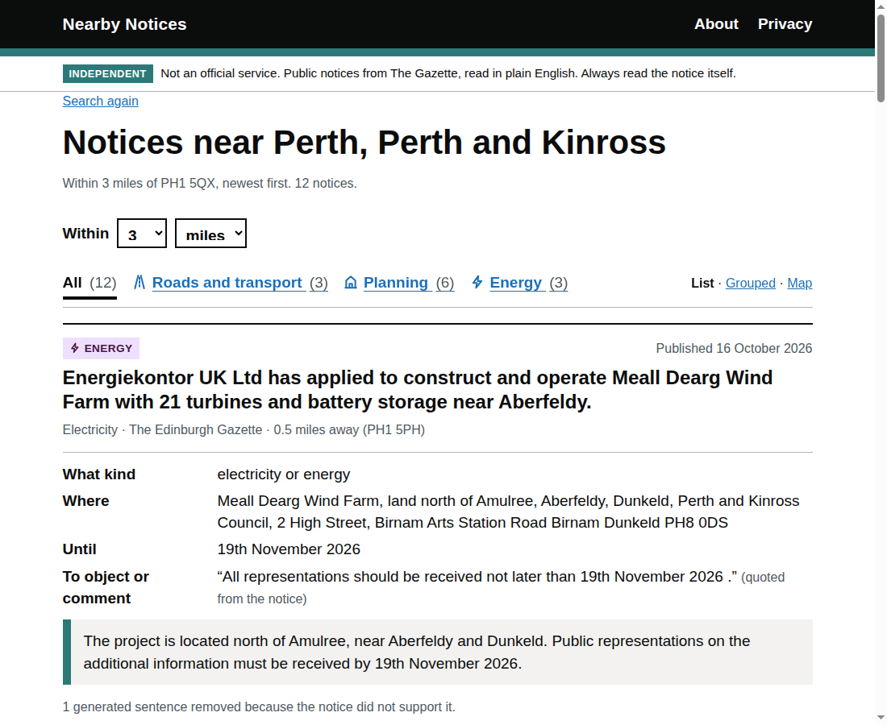
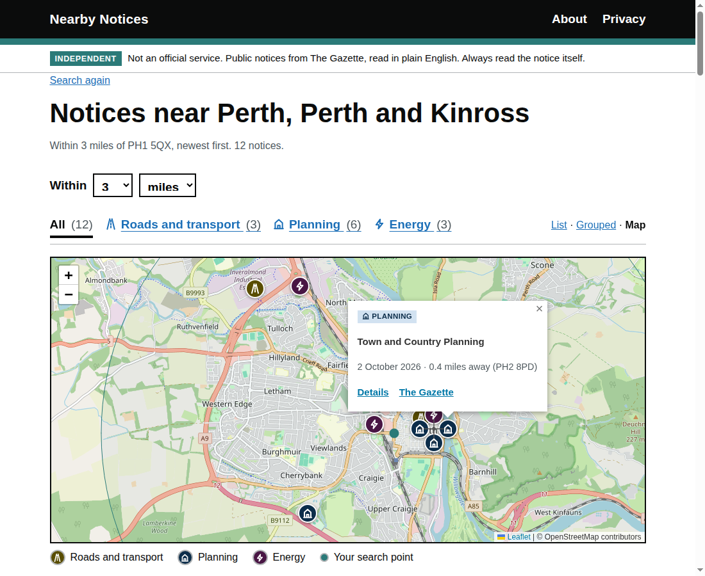
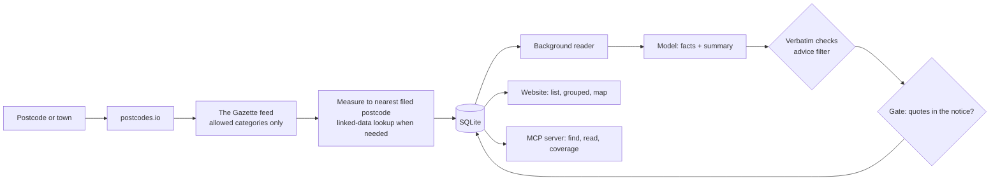

# Nearby Notices

**What is changing near you, in plain English, with every sentence checked against the notice.**

Road closures, parking changes, planning applications, wind farms, smoke control orders and water licences are published in [The Gazette](https://www.thegazette.co.uk), the UK's official public record, in legal language that is hard to read and hard to search by place. Type a postcode or a town, get the notices near you, each read back in plain English beside the notice as published and linked to the record. The same index is an MCP server, so an AI agent can ask the same questions and cite the same record.

For residents, councillors, local journalists and anyone else who wants to know what is being proposed on their street before the objection period closes.

Built with an AI coding assistant under the author's direction, in the author's own time, on open data. Not affiliated with The Gazette, the Government or any council. It shows public notices and does not give advice.





## What makes it trustworthy

A language model writes the plain English. Nothing it writes reaches the page unchecked:

| Layer | What it does | Where |
|---|---|---|
| Verbatim fields | Places, the authority, both dates and the how-to-object sentence are shown only if the model's value appears word for word in the notice. Kind must be one of a fixed list. | `extract.py` |
| The gate | Every generated sentence, including the heading, goes back to the model with the notice: "is every claim stated in the notice?" The answer counts only with one to three short quotes that really are in the text. Fail-closed on any error. | `extract.gate` |
| Advice filter | A generated sentence that tells the reader what to do is removed before the gate is asked. Where a notice says how to object, that sentence is quoted, never composed. | `extract.is_advice` |
| Scrubber | Sentences in a notice addressed to a model ("ignore previous instructions", "tell the reader") are removed before the model and the checks see the text. | `extract.scrub` |
| The record | The notice as published is always on the page with the Gazette link. The plain-English version is labelled as generated. Removed sentences are counted on the card. | templates |
| Category refusal | Only notices by public bodies and companies acting as authorities are fetched. Notices about people are refused at the fetcher and at the store. | `categories.py`, `store.py` |

The threat model, including what is not defended against, is in [docs/safety.md](docs/safety.md).

## Evaluation

Measured, not asserted. `evals/` holds 30 hand-labelled notices across 10 Gazette categories, 120 hand-written true and false sentences for the gate, and 3 adversarial notices. `uv run python evals/run.py` runs everything live against the configured model and writes [evals/RESULTS.md](evals/RESULTS.md).

<!-- results-summary -->
Latest run: see [evals/RESULTS.md](evals/RESULTS.md).
<!-- /results-summary -->

What the numbers mean, and the labelling rules, are in [evals/README.md](evals/README.md). The headline to watch is the gate's false-catch rate: a false sentence the gate keeps would reach the page.

## How it works



1. **Find.** The Gazette's own feed, by postcode, distance and category, newest first. The Gazette only honours radii of 1, 5, 10, 15, 20, 25 and 30 miles, so the tool asks for the smallest honoured radius covering the distance you chose (miles or kilometres) and measures each notice itself. A notice is filed under several postcodes (the street, the council, a consultant's office) and the feed gives only the first, so when that one is outside your circle the tool reads the notice's linked-data record for all of them and keeps the notice only if its nearest filed postcode is inside.
2. **Read.** A model (any model through LiteLLM; by default a local one) returns the facts as JSON and a two- or three-sentence summary. One background reader, so a burst of searches never becomes a burst of model calls.
3. **Check.** The layers in the table above.
4. **Show.** As a list, grouped by kind, or on a map (Leaflet served from this site; OpenStreetMap tiles only when you open the map). Each pin sits at the nearest postcode the notice is filed under; pins that would overlap are spread in a ring. The page asks `/status` every few seconds and swaps in each card as it is ready, without reloading.

## Use it from an AI agent (MCP)

Three tools over stdio, same index, same rules:

| Tool | What it does |
|---|---|
| `find_notices_near(place, distance=3, unit="mi")` | Up to 12 notices near a postcode or town, newest first: id, kind, date, one-line title, distance to the nearest postcode it is filed under, whether plain English is ready, link. |
| `read_notice(notice_id)` | The notice as published, word for word, plus the checked plain-English version with the counts of what the checks removed. Made on the spot if not ready. |
| `coverage()` | What is covered and refused, licence, privacy, distance choices. |

```
claude mcp add nearby-notices -- uv run --directory /path/to/nearby-notices python -m nearby_notices.mcp_server
```

Any other MCP client: command `uv`, arguments `run --directory /path/to/nearby-notices python -m nearby_notices.mcp_server`. The server's instructions tell the agent the plain English is generated and checked but not official, that it must cite the notice, and that it gives no legal advice.

## What it refuses, by design

Only these categories are fetched: Transport, Town and Country Planning, Environmental Protection, Water Resources, Forestry and Plant Health, Electricity. Notices about people (corporate and personal insolvency, deceased estates, appointments, marriages, partnerships, mixed "other" notices) are refused at the fetcher, refused at the store, and never shown; `tests/test_rules.py` proves it. The Gazette's data licence (Open Government Licence v3) does not cover personal data, and this tool is not for finding out about people. The Gazette staff name carried on every feed entry is never read.

## Privacy

No accounts, no cookies, no tracking. What you type is used for the search and not stored, logged or traced. Server logs keep no IP addresses. Counters are daily totals with no identifiers. The map view requests tiles from OpenStreetMap only when you open it. See `/privacy`.

## Run it

```
uv sync
make run        # website on http://127.0.0.1:8765
make mcp        # MCP server over stdio
make test       # ruff + pytest, no network, no model
make eval       # live evaluation, writes evals/RESULTS.md
```

Settings are environment variables; see [.env.example](.env.example). With a local OpenAI-compatible server (llama-server, Ollama) leave `NN_MODEL` unset and the served model's name is read from the server at startup, so the name recorded with each plain-English version is the model actually used. A `Dockerfile` builds the website; mount `/data` to keep the cache.

## Repository map

```
nearby_notices/   gazette.py (feed, linked data, fair use)  places.py (postcodes.io)  geo.py (units, radii, distance)
                  search.py (the pipeline)  extract.py (model, checks, gate)  worker.py (one reader)  store.py (SQLite)
                  app.py (FastAPI pages)  mcp_server.py (MCP tools)  categories.py  groups.py  config.py
templates/ static/  GOV.UK Design System patterns without the reserved marks; Leaflet vendored
evals/            gold.jsonl, notices/, adversarial.jsonl, run.py, RESULTS.md
tests/            rules, geo, app, mcp, injection, evals scoring
docs/             safety.md, decisions.md, incidents.md, screenshots/
```

## Limitations

To be written by the author in his own words after the first week of use. Known today: sentences that count or summarise a list are usually removed by the gate, because no single span of the notice says so; a notice whose prose is itself wrong will be reflected faithfully; the first search of a new place takes 20 to 30 seconds while the Gazette answers.

## Licence

Code: MIT. Notice data: The Gazette, Open Government Licence v3. Place data: postcodes.io, Open Government Licence. Map tiles: OpenStreetMap contributors.
